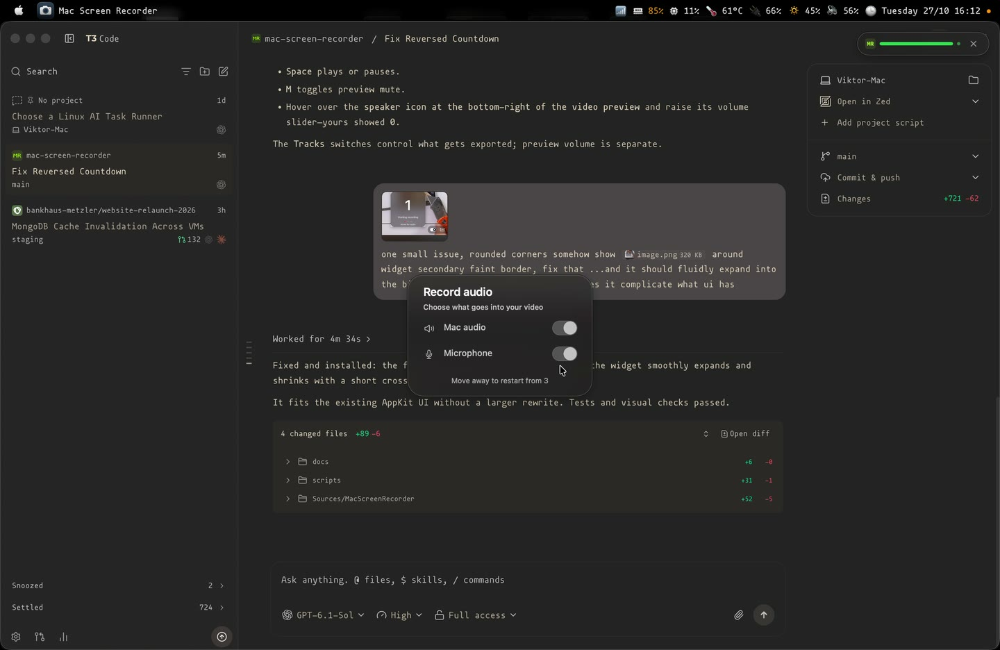

# Mac Screen Recorder

A small native macOS menu bar app: open it for a floating **3, 2, 1** countdown, then record. Click the red dot or press **⌘⌥⇧S** to stop and reveal the saved H.264 MP4 in Finder. Press **⌘⌥⇧T** instead to stop and open the recording in LosslessCut, ready to trim. Videos are saved in `~/Documents/Videos`; the recorder quits after opening the destination.

No ffmpeg, conversion, recording window, Dock icon, or third-party dependencies.

## Preview

Hover to choose Mac audio and microphone, then move away to restart the countdown.

[](docs/media/preview.mp4)

[Watch or download the preview MP4](docs/media/preview.mp4) (18 seconds, 537 KB).

## Use

Requires **macOS 15 or later**. Build with Xcode 16+ / Swift 6+ and its command line tools:

```sh
./scripts/install.sh
open "/Applications/Mac Screen Recorder.app"
```

The installer builds the camera-icon app, signs it with a persistent local certificate, and installs it into `/Applications`. It does not launch the app or start recording. Run the same script after pulling updates. Stop an active recording before installing.

On first launch, allow **Screen & System Audio Recording** in System Settings → Privacy & Security. macOS may require you to quit and reopen the app after granting access. Documents access may also need approval. Once capture is ready, a small centered widget shows 3, 2, 1 for one second each, then disappears before recording starts. It does not take keyboard focus. Click the menu bar dot or press either stop shortcut during the countdown to cancel without creating a recording or opening another app.

Hover over the countdown to replace it with audio controls and pause it. The compact panel shows muted **Finder** and **LosslessCut** shortcut hints (**⌘⌥⇧S** / **⌘⌥⇧T**) along the bottom; either shortcut cancels while the countdown is running. Click the red **Cancel** button at the top right to cancel without creating a recording. Enable **Mac audio** to include the Mac's sound, **Microphone** to include the default input device, or both. Both switches start off for each recording. Moving away restarts the full **3, 2, 1** countdown with your choices; hovering again lets you revise them. The controls stay paused while macOS asks for microphone permission. If access is denied, the microphone switch stays off and a warning icon opens its System Settings permission page. System audio and microphone audio are included in the MP4 through native ScreenCaptureKit recording.

- **Red dot:** recording. Click it (either mouse button) or press **Command + Option + Shift + S** anywhere to stop.
- **Stop and trim:** press **Command + Option + Shift + T** to finalize the MP4 and open it in LosslessCut. The first stop request chooses the destination; repeated shortcuts during saving do not switch it.
- **Orange dot:** starting or finalizing the MP4. A stop during startup cancels capture or stops it as soon as startup completes.
- **After saving:** the normal stop opens Finder with the saved video selected; the trim shortcut opens LosslessCut with that video. Open the recorder again for another recording.
- **Files:** local timestamps such as `2026-10-27_10-45-12-345.mp4`. Collisions receive `-2`, `-3`, etc.; existing videos are preserved.

The app records the **main display and cursor**, with optional **Mac audio and microphone**, at up to 30 fps in SDR. Retina resolution is preserved up to a 3840 × 2160 bounding box; larger, portrait, and ultrawide screens are scaled proportionally to fit. The menu bar is part of the captured display. macOS may also show its own capture indicator or permission reminders.

Install the optional trim editor with `brew install --cask losslesscut`. The recorder supports the Homebrew/GitHub and Mac App Store bundle identifiers, plus the standard `/Applications` and `~/Applications` locations. It opens the completed file through macOS LaunchServices, with no AppleScript, Accessibility, or Automation permission required. If LosslessCut is missing or cannot launch, the original MP4 remains saved, Finder reveals it, and the recorder shows the error. Trimming/exporting is performed by you in LosslessCut; the recorder never overwrites the original file.

## How it saves MP4 directly

`SCStream` captures the display. On macOS 15+, `SCRecordingOutput` handles live encoding and file writing with `videoCodecType = .h264` and `outputFileType = .mp4`. It is attached **before** starting capture so the first frame is included.

Stopping calls `stopCapture()`. The app retains the capture objects until `recordingOutputDidFinishRecording`, which signals that the MP4 is ready. Finalization takes a short time; there is no post-recording transcode. Force Quit, a crash, or power loss can leave an incomplete MP4. On errors, any partial file is retained, and the app shows the error rather than claiming it saved successfully.

See [the research notes](docs/research.md) for API choices and Apple sources.

## Develop and verify

```sh
swift test
./scripts/build.sh
"dist/Mac Screen Recorder.app/Contents/MacOS/MacScreenRecorder" --check-permission
```

`--check-permission` prints the current permission status and exits without requesting access or recording. Permissions observed from a terminal can differ from a Finder launch; test the installed app as well.

Once permissions are granted, this shows the normal countdown, records a three-second smoke-test clip into the normal destination, opens Finder, and exits after finalization:

```sh
open -W "dist/Mac Screen Recorder.app" --args --smoke-test
```

Check the resulting `.mp4` in QuickTime or, optionally, with `ffprobe`. Also test a normal launch followed by the global shortcut and another launch followed by a dot click. Confirm that the dot disappears only after saving, each file plays through its end, and repeated stop presses do not interrupt finalization.

To exercise the trim destination automatically after a three-second recording, use `--smoke-test-trim` instead of `--smoke-test`. This creates a real MP4 and opens LosslessCut with it. Both stop shortcuts also cancel the startup countdown without opening an editor or creating a recording.

The Carbon routing check registers both shortcuts, sends app-local hotkey events to verify their distinct actions, rejects unrelated identifiers, and verifies cleanup. Run it while the recorder is stopped:

```sh
xcrun swiftc -parse-as-library Sources/MacScreenRecorder/GlobalShortcut.swift scripts/test-shortcuts.swift -o dist/test-shortcuts
./dist/test-shortcuts
```

Swift tests cover filename collisions, folder errors, encoder-safe capture dimensions, and countdown pauses/resets across hover and permission changes. The native HUD check exercises the actual tracking-event handlers, switches, repeated restarts, cancellation, and hide delay without recording the desktop:

```sh
./scripts/test-countdown.sh
```

The HUD check saves images in `dist/` for layout inspection. Its permission checks use simulated responses and do not change macOS permissions. These checks do not replace a real capture test with macOS permission granted. To check audio manually, record with each combination of switches, play a sound for Mac audio, speak into the microphone, and confirm playback includes only the sources you enabled.

For a three-second capture through the production recorder without opening Finder, run `./scripts/test-audio-recording.sh` (audio off), add `--system-audio`, add `--microphone`, or add both. This writes a real MP4 into `~/Documents/Videos` and prints its path. Microphone checks require permission already granted to the launching context; they do not request it.

The build script packages a standalone `.app` with a camera icon in `dist/`. No Xcode project generator is required; `Package.swift` can also be opened in Xcode.

## Measure startup delay

Run a short recording with opt-in monotonic timing diagnostics:

```sh
"/Applications/Mac Screen Recorder.app/Contents/MacOS/MacScreenRecorder" --measure-startup --smoke-test 2> dist/startup-timing.log
```

Each `STARTUP_TIMING` line contains JSON with a stage and elapsed milliseconds since app entry. Stages cover launch, permission, content discovery, countdown visibility, the 150 ms hide delay, output setup, capture startup, the first complete frame's arrival, and the native recording-start callback. This command creates a normal three-second clip and opens Finder afterward.

Normal launches do not enable timing logs or the diagnostic frame observer. The first-frame measurement is callback arrival time, not a measurement of when pixels reached the display or were committed to disk. The recording-start callback is measured separately from `startCapture()` returning. See [the measured startup report](docs/startup-timing.md) for results and limitations.

## Permission continuity across updates

Local builds create a **persistent, app-specific signing certificate** once and reuse it. The private key is stored in a dedicated Keychain under `~/Library/Application Support/Mac Screen Recorder/Signing`, outside the repository. The directory and its password file are restricted to your user. The key's access controls authorize `/usr/bin/codesign` and configure the Apple signing partitions so subsequent builds do not need a Keychain approval dialog. Setup trusts this certificate for **code signing only**, in your user's trust settings. It does not change TLS trust, system roots, or Gatekeeper policy.

Every build keeps the same bundle identifier and a designated requirement pinned to that certificate. The installer checks that the installed app and update satisfy each other's requirements before replacing the app at its fixed `/Applications` path. It refuses a mismatched signer, leaves an active recording alone, and restores the old app if replacement fails.

Grant screen-recording permission once to the installed app. Updates installed with `./scripts/install.sh` preserve its signing identity, avoiding the changing-build identity that causes repeated authorization. Migrating from the old ad-hoc build may require one new grant. **Keep the Signing directory**: losing it or switching signing certificates can require permission again. Back it up securely with your Mac; never commit it or upload it to GitHub.

macOS retains control over first-use consent, revoked permissions, and periodic screen-recording reminders; the app cannot guarantee that the operating system will never show a prompt. See [Apple's designated-requirement explanation](https://developer.apple.com/documentation/technotes/tn3127-inside-code-signing-requirements).

Set `SIGNING_IDENTITY` to use your own existing certificate instead. `SIGNING_IDENTITY=- ./scripts/build.sh` produces an ad-hoc test artifact; the installer rejects it. Public binary distribution should use Developer ID signing and notarization. The default certificate is local to this Mac and is not an Apple Developer ID.

GitHub Actions runs tests, builds the app on macOS, and uploads a zipped app artifact. Downloaded ad-hoc builds may be blocked by Gatekeeper; building locally is the supported initial installation path.
